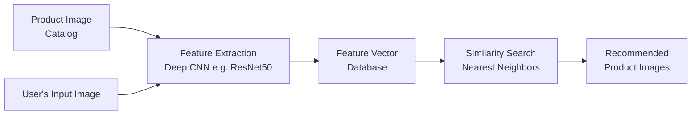

# Trend Rush: AI-Powered Fashion Recommendation System 👗

**Trend Rush** is an intelligent e-commerce platform that uses machine learning to deliver personalized, image-based fashion recommendations. The system analyzes visual product data to help users discover items they'll love.


*An AI system providing personalized shopping suggestions.*

##  Project Overview & Key Features

Trend Rush reimagines online shopping by focusing on visual discovery. Instead of relying only on text searches or basic categories, our core system finds products that are **visually similar** to what a user likes.

*   **Visual Product Search**: Upload an image or choose a product to find visually similar items instantly.
*   **Personalized User Feed**: Recommendations adapt based on your browsing and interaction history.
*   **Seamless E-commerce Integration**: Full-featured shopping cart, user profiles, and checkout functionality.
*   **Modern, Responsive UI**: Built with a focus on aesthetics and usability across all devices.
*   **Scalable ML Backend**: Designed to handle large catalogs with efficient similarity search.

## 🏗️ System Architecture & Tech Stack

Trend Rush is a full-stack application that combines a modern web frontend with a powerful Python-based machine learning backend.

| Layer | Technology | Purpose |
| :--- | :--- | :--- |
| **Frontend** | HTML, CSS, JavaScript | Interactive user interface and product displays. |
| **Backend Framework** | Python (Django) | Application logic, user management. |
| **ML & Core Intelligence** | TensorFlow, Scikit-learn | Deep learning for image feature extraction and similarity calculations. |
| **Database** | SQLite (Development) | Stores product data, user information, and interactions. |
| **Version Control** | Git & GitHub | Collaboration and code management. |

## 🧠 How the Image Recommendation Engine Works

The magic behind Trend Rush is a **Similarity Model**. Here’s a simplified view of the process:



1.  **Feature Extraction**: Each product image is passed through a pre-trained deep convolutional neural network (like **ResNet50** or **VGG**). The network converts the image into a compact "feature vector" (or embedding) that captures its visual essence—patterns, colors, shapes, and textures—while discarding unnecessary details.
2.  **Indexing**: All product feature vectors are stored in a search-optimized index.
3.  **Similarity Search**: When a user interacts with a product, the system calculates its feature vector and uses a **Nearest Neighbors algorithm** to find the vectors (and thus products) closest to it in the mathematical "feature space".
4.  **Recommendation**: The most similar products are retrieved and displayed as personalized recommendations.

This approach, often based on **contrastive learning**, trains the model to minimize the distance between similar items (e.g., two dresses) and maximize the distance between dissimilar ones (e.g., a dress and a pair of boots) in the embedding space.

## 📁 Project Structure

```
Fashion-Trend/
│
├── app/                           # Main application module (models, views)
├── ecommerce/prodimg/             # Directory for product images
├── static/app/                    # Static assets (CSS, JS, compiled resources)
├── templates/                     # HTML templates for web pages
├── testbca/                       # Test scripts or modules
│
├── db.sqlite3                     # SQLite database file
├── manage.py                      # Django management script
├── main1.py                       # Main application script or ML pipeline
├── requirements.txt               # Python dependencies
└── README.md                      # This file
```

## 🚀 Getting Started

### Prerequisites
- Python 3.8+
- pip

### Installation & Setup

1.  **Clone the repository**
    ```bash
    git clone https://github.com/Bibekbb/Fashion-Trend.git
    cd Fashion-Trend
    ```

2.  **Create and activate a virtual environment**
    ```bash
    python -m venv venv
    # On Windows
    venv\Scripts\activate
    # On macOS/Linux
    source venv/bin/activate
    ```

3.  **Install Python dependencies**
    ```bash
    pip install -r requirements.txt
    ```
    *(If `requirements.txt` is not present, you may need to create it with core packages like `django`, `tensorflow`, `numpy`, `scikit-learn`, and `pillow`.)*

4.  **Set up the database and run migrations (if using Django)**
    ```bash
    python manage.py migrate
    ```

5.  **Run the development server**
    ```bash
    python manage.py runserver
    # Or, run the main application script
    # python main1.py
    ```

6.  **Access the application**
    Open your browser and navigate to `http://127.0.0.1:8000`.

